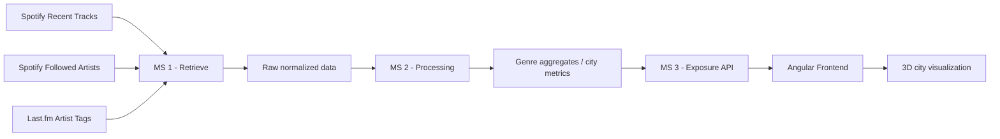
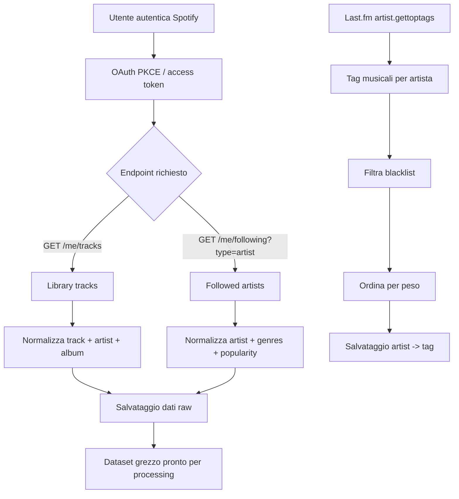
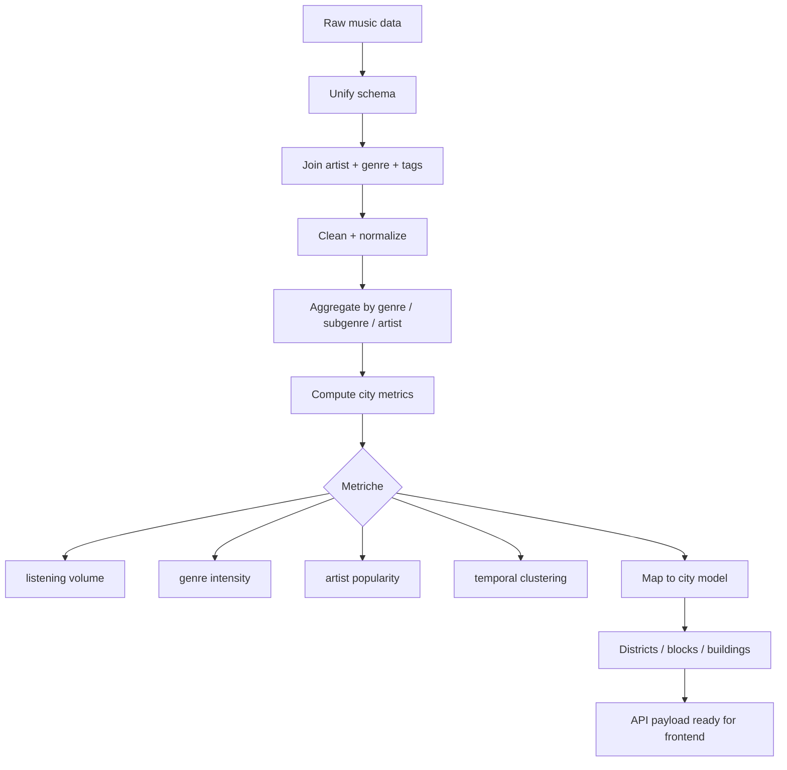
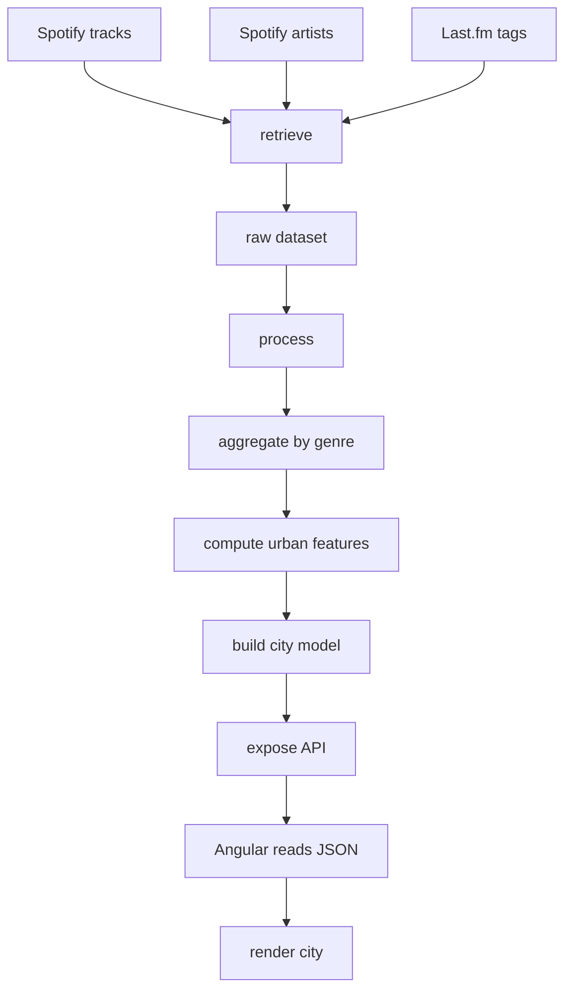

# Cityfy

Cityfy è un progetto che trasforma i dati musicali personali in una rappresentazione urbana generativa.
L’idea centrale è semplice: i brani ascoltati, i generi e i sotto-generi diventano elementi di una città, dove ogni quartiere, blocco e edificio rappresenta un aspetto del profilo musicale dell’utente.

L’obiettivo è costruire una “città dell’ascolto” partendo da dati provenienti da Spotify e arricchiti con metadata di artisti e tag musicali da Last.fm. Il risultato finale è una visione grafica della propria identità musicale, resa come una mappa urbana o una scena 3D in cui:

- il genere diventa un quartiere
- il sotto-genere diventa una zona o un blocco
- l’artista diventa un edificio
- l’intensità di ascolto definisce l’altezza e la densità

---

## Avvio in locale (solution .NET)

### Prerequisiti
- .NET SDK 10
- Docker Desktop **avviato**: MongoDB, SQL Server e RabbitMQ girano come container gestiti da Aspire.

### Configurazione (una volta sola)
Lo Spotify Client Secret è un parametro dell'AppHost. Si imposta con:

```powershell
dotnet user-secrets set "Parameters:spotify-client-secret" "<client secret>" --project CityFy\CityFy.AppHost
```

In alternativa, la dashboard di Aspire lo chiede al primo avvio. Le password di Mongo, SQL Server e RabbitMQ le genera Aspire e le salva negli user-secrets dell'AppHost: non vanno configurate a mano.

### Avvio
```powershell
dotnet run --project CityFy\CityFy.AppHost
```

La dashboard di Aspire (l'URL compare nel terminale) mostra:
- lo stato dei servizi;
- i log;
- le tracce distribuite;
- gli endpoint di ogni servizio. Swagger è disponibile su `/swagger` di ciascun servizio.

I container hanno lifetime *persistent* e volumi dati, quindi restano attivi e conservano i dati tra un avvio e l'altro. Mongo Express (interfaccia web per Mongo) è raggiungibile dalla dashboard.

### API pubblica (CityFy.Api)
Il frontend parla solo con **Api** (`https://localhost:7300`, Swagger su `/swagger`), passando dal proxy del dev server. Gli altri servizi sono interni.

| Endpoint | Descrizione |
|---|---|
| `GET /api/v1/auth/login?returnUrl=/...` | Accesso con Spotify (navigazione del browser, non fetch) |
| `GET /api/v1/auth/callback` | Redirect URI di Spotify: apre la sessione (cookie `cityfy.auth`) |
| `POST /api/v1/auth/logout` | Chiude la sessione |
| `GET /api/v1/me` | Utente corrente e ultimo aggiornamento da Spotify |
| `GET /api/v1/cities?page=&pageSize=` | Città salvate (paginate) |
| `POST /api/v1/cities` | Genera una città (date, mappa, generi; 202) |
| `GET /api/v1/cities/{id}`, `DELETE`, `POST .../cancel` | Città (dati + mappa), cancellazione, annullamento |
| `GET /api/v1/cities/recipe/schema` | Parametri della mappa personalizzata |
| `GET /api/v1/city/genres?from=&to=` | Generi e sottogeneri ascoltati, per il form |
| `POST /api/v1/city/rebuild` | Aggiorna subito il catalogo artisti |
| `POST /api/v1/uploads`, `GET /api/v1/uploads/{id}` | Caricamento dell'export e suo stato |
| `POST /api/v1/spotify/sync`, `GET /api/v1/spotify/sync/{id}` | Aggiornamento immediato da Spotify |
| `GET /api/v1/pipeline/runs` | Stato degli aggiornamenti del catalogo artisti |

**Configurazione del login Spotify.** Registrare sulla dashboard Spotify la redirect URI `http://127.0.0.1:4200/api/v1/auth/callback`. È già il valore di `Spotify:RedirectUri` negli appsettings di Retrieve.Spotify, e ngrok non serve. Spotify accetta `http` solo sull'indirizzo di loopback `127.0.0.1`, non su `localhost`.

**Accesso pubblico con ngrok (opzionale).** Se in `CityFy.AppHost/appsettings.json` è valorizzato `Ngrok:Url` (per esempio `https://<nome>.ngrok-free.dev`), l'AppHost avvia anche la risorsa **Ngrok**. È la CLI `ngrok` locale, con il tuo authtoken, e apre un tunnel verso il **frontend** (porta 4200). In questo caso:
- la redirect URI di Spotify e l'indirizzo del frontend passano automaticamente all'URL ngrok;
- sulla dashboard Spotify va registrato anche `<Ngrok:Url>/api/v1/auth/callback`;
- l'app va aperta dall'URL ngrok: il login da `127.0.0.1` non funziona più, perché Spotify rimanderebbe all'URL ngrok.

Lasciando `Ngrok:Url` vuoto si torna al funzionamento solo locale su `127.0.0.1`.

### Frontend (cityfy-web)
L'app Angular (`cityfy-web/`, nella root del repo) parte insieme al resto con l'AppHost (risorsa **Web**). L'indirizzo è **http://127.0.0.1:4200**: va usato proprio `127.0.0.1`, non `localhost`, altrimenti il login Spotify non torna sulla stessa origine.

Il dev server inoltra `/api` all'API (`proxy.conf.mjs`). In questo modo browser, callback di Spotify e cookie di sessione stanno sulla stessa origine e non serve configurare CORS.

Per avviarlo da solo, con l'API già in esecuzione:
```powershell
cd cityfy-web
npm install
npm start
```

- **Test:** `npm run test:ci` (Vitest).
- **Angular 21, non 22:** Angular 22 richiede Node ≥ 22.22, qui è installata la 22.17. Si può aggiornare dopo aver aggiornato Node.
- **`.npmrc`:** contiene `legacy-peer-deps=true` per aggirare un bug di npm 10 nella risoluzione delle dipendenze peer.

### Pannello admin
**http://127.0.0.1:4200/admin** (o `<URL ngrok>/admin`). Utente di sviluppo definito nella configurazione dell'API, sezione `Admin`: **`admin` / `cityfy-admin`**.

Il pannello è attivo solo in Development (`appsettings.Development.json` dell'API). Fuori da Development gli endpoint `/api/admin/*` rispondono 404.

| Sezione | Cosa permette |
|---|---|
| Servizi e log | Stato `/health` di ogni servizio, link a log strutturati e tracce (dashboard Aspire) e a RabbitMQ (code e DLQ) |
| MusicBrainz | Avvio dell'import del catalogo generi e avanzamento |
| Pipeline | Esecuzioni dell'orchestratore di tutti gli utenti, aggiornamento manuale del catalogo artisti di un utente |
| Spotify e upload | Account collegati con sincronizzazione su richiesta, elenco degli upload con stato e codice d'errore, **cancellazione di tutti i dati di un utente** (anche indicando lo userId a mano) |
| Database | Sola lettura con paginazione: collection Mongo (`cityfy`) e tabelle SQL Server (`musicbrainz`). I campi sensibili (token, secret, password) sono oscurati |

### Primo giro completo
1. **Generi:** `POST /api/retrieve` su **RetrieveMusicBrainz**. Scarica e importa il dump MusicBrainz. Dura a lungo; lo stato si legge su `GET /api/retrieve/status`.
2. **Ascolti:** si possono caricare in due modi:
   - `POST /internal/uploads` su **RetrieveDumpSpotify**, con il file dell'export e lo `userId`;
   - login su `/debug/spotify/login` di **RetrieveSpotify**, poi `POST /debug/spotify/start/{userId}`.
3. **Catalogo artisti:** si aggiorna da solo. Circa 30 secondi dopo l'ultimo import con nuovi ascolti, l'**Orchestrator** chiede a **Catalog** di ricalcolarlo (`RefreshCatalogRequested`); la run si chiude con `UserCatalogUpdated` o `CatalogRefreshFailed`.
   - Avanzamento: `GET /api/pipeline/runs?userId=...` su **Orchestrator**.
   - Aggiornamento senza nuovi import: dal pulsante **Aggiorna i dati** nella lista delle città (`POST /api/v1/city/rebuild`, usa tutti gli ascolti importati da qualunque fonte), oppure `POST /internal/pipeline/trigger/{userId}` su **Orchestrator**; in debug `POST /debug/catalog/refresh/{userId}` su **Catalog**.
   - Quando un import di MusicBrainz finisce, **RetrieveMusicBrainz** pubblica `CatalogUpdated` e l'Orchestrator aggiorna il catalogo di tutti gli utenti che hanno ascolti. Le città già salvate restano com'erano; quelle nuove usano i generi aggiornati.
   - Una città ha al massimo `City:MaxDistricts` quartieri (default 12); i macro-generi meno ascoltati finiscono nel quartiere "Altri generi".
   - **Catalogo artisti:** a ogni run Catalog ricalcola, su tutti gli ascolti, genere e sottogenere di ogni artista (`user_artist_placements`, versione corrente in `user_catalogs`) e pubblica `UserCatalogUpdated`. Le città di qualunque intervallo e genere si calcolano da qui senza richiamare MusicBrainz: `POST /api/catalog/city-model/{userId}`, `GET /api/catalog/genres/{userId}?from&to`.

4. **Città salvate (CityGenerator):** l'utente genera una città scegliendo date, tipo di mappa (`organic`, `grid`) e generi o sottogeneri (`POST /api/v1/cities`). La generazione è un job in background (`GenerateCityRequested`) che chiede i dati a Catalog e salva il risultato in `generated_cities`.
   - Lista paginata `GET /api/v1/cities`, dettaglio `GET /api/v1/cities/{cityId}`, cancellazione `DELETE /api/v1/cities/{cityId}`, annullamento `POST /api/v1/cities/{cityId}/cancel`; generi disponibili `GET /api/v1/city/genres?from&to`.
   - Al massimo `CityGenerator:MaxCitiesPerUser` città per utente (default 10, poi `CITY_LIMIT_REACHED`). Una richiesta identica sullo stesso catalogo riusa la città esistente.
   - Dopo il primo import, un utente senza città ne riceve una "tutto il periodo, organica, tutti i generi".

   **La mappa:** la calcola CityGenerator (`CityLayoutSubService`) quando genera la città, e il browser la disegna così com'è (three.js). Due tipi di mappa:
   - **Organica:** quartieri irregolari che coprono tutta la città (Voronoi pesato, aree proporzionali agli edifici). Al centro di ogni quartiere c'è una piazza con rotonda, i blocchi dei generi stanno attorno a spicchi;
   - **Griglia:** isolati rettangolari e strade dritte, come Manhattan.

   In tutti i tipi:
   - i generi con più di 16 artisti sono divisi in isolati da strade interne;
   - ogni isolato ha un marciapiede rialzato;
   - le strade hanno la segnaletica orizzontale: mezzeria tratteggiata, doppia linea continua sulle strade principali, strisce pedonali agli incroci;
   - c'è anche la segnaletica verticale: lampioni, semafori sulle strade principali, cartelli di stop, dare precedenza e attraversamento pedonale.

   Le strade sono ricavate dalla geometria: il bordo condiviso tra due celle è l'asse di una strada (`Models/Layout/StreetPlan.cs`). I golden test (`CityFy.CityGenerator.Tests/Golden`) fissano le mappe di alcune città di esempio.

   **Nel browser:** `/cities` è la lista delle città salvate, `/cities/new` il form (nome facoltativo, date con scorciatoie, tipo di mappa, generi e sottogeneri), `/cities/{id}` la città con legenda e dettaglio dell'artista.
   **Cancellazione dei dati:** cliccando il proprio nome nella barra si apre "Il tuo account" con **Cancella i miei dati** (`DELETE /api/v1/me/data`); l'admin fa lo stesso dal pannello (`DELETE /api/admin/users/{userId}/data`). L'Api chiama `DELETE .../users/{userId}/data` su ogni servizio che possiede dati dell'utente, in quest'ordine:
   1. **RetrieveSpotify:** ferma i retrieve, cancella i job e l'account collegato con il refresh token;
   2. **RetrieveDumpSpotify:** ferma gli import, cancella gli upload, gli zip e i file estratti su disco;
   3. **Orchestrator:** cancella le esecuzioni della pipeline;
   4. **CityGenerator:** ferma le generazioni e cancella le città salvate;
   5. **Catalog:** cancella ascolti e catalogo artisti.

   Ogni passo si può ripetere senza problemi: se un servizio non risponde gli altri completano comunque la loro parte, e la risposta è `USER_DATA_DELETION_INCOMPLETE` (basta riprovare). Un aggiornamento del catalogo già in corso non salva nulla per un utente rimasto senza ascolti.

   **Tema chiaro/scuro:** il pulsante ◐/☀/☾ nella barra passa tra automatico (come il sistema), chiaro e scuro; la scelta resta salvata nel browser. In tema scuro la città è di notte: lampioni accesi, edifici illuminati.

   **Link a Spotify:** nel dettaglio dell'artista. L'export di Spotify non contiene gli id degli artisti: in quel caso si usa il link Spotify che MusicBrainz conosce per l'artista; se manca anche quello, il pulsante diventa "Cerca su Spotify".

   Navigazione da mappa: trascinare per spostarsi, tasto destro per ruotare, rotella per lo zoom verso il cursore, WASD/frecce e Q/E, doppio clic per avvicinarsi, minimappa cliccabile in basso a sinistra.

   Il retrieve Spotify parte da solo ogni 30 minuti per tutti gli account collegati (`Spotify:ScheduledRetrieveMinutes`).

### Pipeline a eventi (RabbitMQ)
```
Dump.Spotify   upload ──► UploadReceived ──► import ──► ListeningImported ─┐
Spotify        retrieve (manuale o programmato) ───────► ListeningImported ─┤
MusicBrainz    import finito ──► CatalogUpdated (aggiorna tutti i cataloghi)│
Orchestrator   ListeningImported ──► debounce ──► RefreshCatalogRequested ─►│
Catalog        RefreshCatalogRequested ──► UserCatalogUpdated | CatalogRefreshFailed
Orchestrator   pipeline run ──► DONE | FAILED ◄─────────────────────────────┘
CityGenerator  UserCatalogUpdated ──► prima città di un utente nuovo
CityGenerator  POST /api/v1/cities ──► GenerateCityRequested ──► dati da Catalog ──► Done | Failed
```

**Struttura delle code:**
- tutti i messaggi passano sull'exchange `cityfy.events`;
- ogni consumer ha la propria coda, più tre code di ritardo per i retry (5 s, 30 s, 2 min) e una coda `.dlq` per i messaggi che falliscono tutti i tentativi;
- i contratti dei messaggi sono in `ServiceDefault/Contracts`.

Il pannello di gestione di RabbitMQ è raggiungibile dalla dashboard di Aspire.

### Errori
Tutti i servizi rispondono agli errori con `application/problem+json`, cioè ProblemDetails con due campi aggiuntivi:
- `code`: codice stabile, definito in `ServiceDefault/Errors/ErrorCodes.cs`;
- `traceId`: identificativo per ritrovare la richiesta nei log.

Anche upload, job Spotify ed esecuzioni della pipeline espongono un `errorCode` quando falliscono. La città espone `warnings`.

Il catalogo per la grafica e il frontend è in [ERRORI_UI.md](ERRORI_UI.md). Un test fallisce se un codice del backend non vi è documentato.

### Test
```powershell
cd CityFy
dotnet test --solution CityFy.slnx
```

I test di integrazione su Mongo usano Testcontainers: se Docker non è attivo vengono saltati.

### Migration EF (Retrieve.MusicBrainz)
Gli strumenti `dotnet ef` hanno bisogno di una connection string, perché quella vera la inietta l'AppHost solo a runtime:

```powershell
$env:ConnectionStrings__musicbrainz = "Server=localhost,1433;Database=musicbrainz;User Id=sa;Password=...;TrustServerCertificate=True"
dotnet ef migrations add <Nome> --project CityFy\CityFy.Retrieve.MusicBrainz
```

---

## Deploy

Pubblicazione a costo zero su una macchina gratuita di Oracle Cloud, con il catalogo su Azure SQL gratuito. GitHub Actions esegue i test e pubblica a ogni push su `main`. La guida completa è in [DEPLOY.md](DEPLOY.md).

---

## Architettura del progetto

Il progetto è pensato come una pipeline in 3 parti:

1. Retrieve
   - recupero dati grezzi da Spotify
   - recupero metadata di artisti e generi
   - arricchimento da Last.fm
   - salvataggio dei dati raw

2. Processing
   - pulizia e normalizzazione
   - aggregazione per genere, sotto-genere e artista
   - trasformazione in feature urbane
   - costruzione del modello città

3. Exposure API
   - esposizione dei dati elaborati
   - endpoint REST per il frontend
   - consumo da Angular per la visualizzazione

---

## Flusso alto livello



---

## 1) Retrieve

La prima parte del sistema raccoglie dati grezzi da fonti esterne. Nel progetto attuale i flussi principali sono implementati in:

- [spotify_data/spotify_library.py](spotify_data/spotify_library.py)
- [spotify_data/spotify_artist_follow.py](spotify_data/spotify_artist_follow.py)
- [spotify_data/lastfm_genres.py](spotify_data/lastfm_genres.py)

### Flusso di retrieve



### Dati recuperati

Da Spotify:
- tracce ascoltate
- artisti seguiti
- generi associati agli artisti
- popularity e follower count
- album e artist metadata

Da Last.fm:
- top tags per artista
- classificazione per genere e sotto-genere
- in particolare i tag che descrivono il profilo musicale dell’artista

### Esempio di dati grezzi

```json
{
  "trackId": "abc123",
  "trackName": "Midnight City",
  "artistId": "artist1",
  "artistName": "M83",
  "albumId": "album1",
  "albumName": "Hurry Up, We're Dreaming",
  "addedAt": "2026-09-01T10:22:00Z",
  "durationMs": 270000,
  "genres": ["electronic", "indie pop"]
}
```

---

## 2) Processing

Una volta raccolti i dati grezzi, si applica la fase di elaborazione. L’obiettivo è trasformare il profilo musicale in una struttura urbana.

### Flusso di processing



### Logica di trasformazione

La mappatura logica è la seguente:

- genere principale → quartiere
- sotto-genere → blocco o zona
- artista → edificio o cluster di edifici
- numero di ascolti → altezza edificio
- intensità del genere → densità del quartiere
- categoria musicale → colore del quartiere / edificio

### Esempio di trasformazione

```text
electronic
  -> quartiere "Electronic District"
  -> colore blu / verde
  -> densità alta se l'utente ascolta molto musica elettronica

house / deep house / techno
  -> sotto-zone del quartiere
  -> blocchi con altezza variabile in base al listening score

M83 / Daft Punk / Massive Attack
  -> edifici distinti
  -> altezza proporzionale alla frequenza di ascolto
```

---

## 3) Exposure API

La terza parte del sistema espone i dati elaborati tramite API REST; il frontend Angular si occupa poi della renderizzazione grafica.

### Obiettivo delle API
- restituire la città generata
- restituire aggregati per genere
- restituire dettagli per quartiere / blocco / artista
- filtrare dati per periodo, genere o artista

### API proposal

```http
GET /api/city
GET /api/city?period=30d
GET /api/genres
GET /api/districts
GET /api/artists/{artistId}
GET /api/genres/{genre}
```

### Esempio payload di risposta

```json
{
  "cityId": "user-spotify-city",
  "generatedAt": "2026-09-12T00:00:00Z",
  "period": "30d",
  "summary": {
    "totalTracks": 1240,
    "totalArtists": 89,
    "topGenres": ["electronic", "rock", "hiphop"]
  },
  "districts": [
    {
      "districtId": "electronic",
      "name": "Electronic District",
      "color": "#4cc9f0",
      "density": 0.82,
      "listeningIntensity": 92.4,
      "buildings": [
        {
          "buildingId": "artist1",
          "name": "M83",
          "height": 26.5,
          "width": 10,
          "color": "#4cc9f0",
          "score": 92.4
        }
      ]
    }
  ]
}
```

---

## 4) Modello backend / domain model

Il backend dovrebbe lavorare con un modello concettuale come questo.

### TrackRecord

```json
{
  "trackId": "abc123",
  "trackName": "Midnight City",
  "artistId": "artist1",
  "artistName": "M83",
  "albumId": "album1",
  "albumName": "Hurry Up, We're Dreaming",
  "addedAt": "2026-09-01T10:22:00Z",
  "durationMs": 270000,
  "genres": ["electronic", "indie pop"],
  "source": "spotify"
}
```

### ArtistProfile

```json
{
  "artistId": "artist1",
  "artistName": "M83",
  "genres": ["electronic", "indie pop"],
  "popularity": 90,
  "followers": 15400000,
  "topTags": ["electronic", "indie", "dream pop"],
  "macroGenre": "electronic"
}
```

### GenreAggregate

```json
{
  "genre": "electronic",
  "subgenres": ["house", "deep house", "techno"],
  "trackCount": 420,
  "artistCount": 35,
  "listeningScore": 92.4
}
```

### CityDistrict

```json
{
  "districtId": "electronic",
  "name": "Electronic District",
  "color": "#4cc9f0",
  "density": 0.82,
  "listeningIntensity": 92.4,
  "buildings": []
}
```

---

## 5) Come dovrebbe essere l’Angular

Il frontend non è solo un semplice viewer: è il layer di presentazione del modello della città.

L’app Angular dovrebbe avere una struttura simile a questa:

```text
app/
  core/
    services/
      city.service.ts
      genre.service.ts
      filters.service.ts

  features/
    city/
      components/
        city-view/
        city-scene/
        district-legend/
      models/
        city.model.ts
        building.model.ts

    filters/
      components/
        genre-filter/
        period-filter/
        artist-search/

  shared/
    components/
      metric-card/
      loading-state/
      empty-state/
```

### Responsabilità dell’Angular

- chiamare l’API di city
- ricevere il JSON del modello
- trasformare i dati in scena grafica
- supportare filtri per genere, artista, periodo
- mostrare un layout urbano con quartieri e edifici

### Logica di rendering

- quartiere = zona della città
- edificio = artista o cluster di artisti
- altezza = intensità di ascolto
- colore = genere / macro-genere
- densità = numero di tracce o ascolti

---

## 6) Flusso completo dal dato alla città



---

## 7) Idea di valore del progetto

Cityfy non è solo una visualizzazione musicale. È una rappresentazione dell’identità sonora dell’utente in forma urbana:

- il tuo consumo musicale diventa paesaggio
- i generi diventano aree geografiche
- la storia dell’ascolto diventa una città dinamica

Questo rende il progetto interessante non solo come app visiva, ma come strumento di analisi del proprio comportamento musicale.

---

## 8) Stack tecnologico

### Attuale
- Vite
- JavaScript / vanilla
- Three.js
- Python per il retrieval e il processing dati

### Evoluzione prevista
- Angular per il frontend
- API REST per l’esposizione
- backend in Node.js o ASP.NET o Java secondo preferenza
- database leggero per dati aggregati (JSON / SQLite / Postgres)

---

## 9) Prossimi step

1. separare il layer di retrieve in microservizio dedicato
2. definire un modello concreto di city JSON
3. creare la struttura Angular di base
4. implementare le API REST
5. collegare il frontend al backend
6. sostituire la città statica con dati dinamici provenienti dalle API

---

## 10) Conclusione

Cityfy combina due elementi:
- analisi dati musicali
- visualizzazione urbana

La sua forza è la trasformazione del comportamento di ascolto in un modello spaziale, dove la città non è un ambiente generico ma una rappresentazione delle tue preferenze musicali.

Questo rende il progetto perfettamente coerente con una architettura a 3 livelli:
- retrieve
- processing
- exposure API
- con Angular come layer di presentazione visiva.
